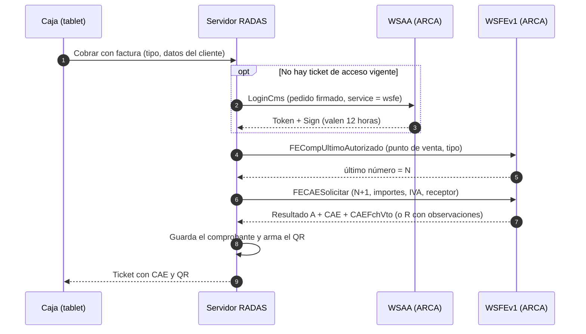

# Facturación electrónica (ARCA): diseño

> **Es un diseño, no está implementado.** RADAS es un bar ficticio: no tiene CUIT, certificado digital ni punto de venta, así que el sistema no emite comprobantes y nada de lo descripto acá tiene valor fiscal. Sirve para mostrar cómo se conectaría el sistema con ARCA (ex AFIP) y qué trabajo falta. Versión visual: [`facturacion-diagrama.html`](facturacion-diagrama.html) (se abre en el navegador; también publicada como página) y la imagen [`facturacion-secuencia.png`](facturacion-secuencia.png) para presentaciones.

## 1. Alta previa (una sola vez, la hace el titular del CUIT)

1. Clave Fiscal del CUIT que factura.
2. Certificado digital: se genera un par de claves propio y ARCA firma el certificado. En homologación (pruebas) se gestiona en WSASS; en producción, con el «Administrador de Certificados Digitales».
3. Asociar el certificado al servicio `wsfe` (factura electrónica): WSASS en pruebas, «Administrador de Relaciones de Clave Fiscal» en producción.
4. Un punto de venta habilitado para facturar por web services.

## 2. Qué pasa al cobrar con factura

- El ticket de acceso (Token y Sign) se pide una vez cada 12 horas y se reutiliza.
- Los pasos «último número» y «solicitar CAE» de un mismo punto de venta y tipo se hacen **de a uno por vez** (cola en el servidor) para que la numeración salga correlativa.

## 3. Si algo sale mal

| Situación | Qué hace el sistema |
|---|---|
| **Resultado A** | Guarda CAE y vencimiento, arma el QR, imprime. Las observaciones, si las hay, se guardan igual. |
| **Resultado R** (rechazada) | El cobro ya está hecho, el comprobante no. Muestra el motivo, permite corregir el dato y reintentar; la cuenta queda «cobrada, sin factura» hasta resolverlo. |
| **Sin respuesta** (internet o ARCA) | Antes de reintentar consulta con `FECompConsultar` si el número N+1 ya se emitió, para no duplicar ni saltear números. El cobro no se bloquea: la factura se emite después. |

## 4. Qué se guardaría

Tabla nueva `comprobante`, ligada a la cuenta cobrada: `id_pedido`, `tipo_cbte`, `pto_vta`, `numero` (únicos juntos con el tipo), `fecha`, `cuit_emisor`, `doc_tipo`, `doc_nro`, `cond_iva_receptor`, `neto`, `iva`, `total`, `cae`, `cae_vto`, `resultado`, `observaciones`, `qr_url`.

Ejemplo, con precio final con IVA incluido y alícuota del 21 % (supuesto): total $10.000,00 → neto 10.000 ÷ 1,21 = $8.264,46 → IVA = 10.000 − 8.264,46 = $1.735,54. ARCA exige que el total sea exactamente la suma de neto, IVA y demás conceptos, por eso el IVA se calcula como diferencia.

## 5. Qué comprobante

Se supone un bar Responsable Inscripto (si fuera monotributista emitiría solo C).

| Cliente | Comprobante | Código (`FEParamGetTiposCbte`) |
|---|---|---|
| Consumidor final | Factura B | 6 |
| Empresa con CUIT que pide discriminar IVA | Factura A | 1 |
| Emisor monotributista | Factura C | 11 |

El manual de ARCA agrupa los códigos por clase (A: 01–05, B: 06–10, C: 11–15); los números exactos de arriba son los habituales, y conviene tomarlos de `FEParamGetTiposCbte` en lugar de dejarlos fijos. La condición de IVA del receptor (`CondicionIVAReceptorId`) figura como opcional desde abril de 2025 y pasa a ser obligatoria según la RG 5616: **verificar la fecha vigente** antes de implementar.

## 6. Direcciones

| Servicio | Ambiente | Dirección |
|---|---|---|
| WSAA | Homologación | `https://wsaahomo.afip.gov.ar/ws/services/LoginCms` |
| WSAA | Producción | `https://wsaa.afip.gov.ar/ws/services/LoginCms` |
| WSFEv1 | Homologación | `https://wswhomo.afip.gov.ar/wsfev1/service.asmx` |
| WSFEv1 | Producción | `https://servicios1.afip.gov.ar/wsfev1/service.asmx` |

Un proyecto de estudiantes tendría que quedarse en **homologación** (comprobantes sin valor fiscal). Las direcciones pueden cambiar: las vigentes están en el manual del desarrollador.

## 7. QR del comprobante

Dirección `https://www.arca.gob.ar/fe/qr/?p=<JSON en Base64>`, con el JSON: `ver` (1), `fecha`, `cuit`, `ptoVta`, `tipoCmp`, `nroCmp`, `importe`, `moneda`, `ctz`, `tipoDocRec`, `nroDocRec`, `tipoCodAut` («E» para CAE) y `codAut` (el CAE). El generador de QR del proyecto (`src/domain/qr.js`, hasta 213 bytes) es demasiado chico para este contenido: habría que ampliarlo antes de usarlo.

## 8. Dónde se tocaría el código

- `sql/schema.sql`: tabla `comprobante`; sumarla a `TABLAS` del respaldo y las rutas nuevas a `ETIQUETAS` de la auditoría (si no, los tests fallan).
- `src/modules/facturacion/`: cliente de WSAA (firma del pedido con el certificado, guarda de Token y Sign), cliente de WSFEv1 y la emisión con su cola.
- `src/domain/`: cálculo de neto e IVA y armado del QR, como funciones puras con pruebas.
- Variables de entorno: CUIT, punto de venta, ruta del certificado y de la clave privada, ambiente. **La clave privada nunca va al repositorio ni a las copias de seguridad.**
- `web/src/pantallas/caja.jsx`: «Cobrar con factura», datos del cliente y reintento.

## Fuentes (consultadas el 20/10/2026)

- Manual para el desarrollador de WSFEv1, RG 4291, versión 4.7: <https://www.arca.gob.ar/ws/documentacion/manuales/manual-desarrollador-ARCA-COMPG.pdf>
- WSAA: <https://www.arca.gob.ar/ws/documentacion/wsaa.asp>
- Código QR en comprobantes electrónicos: <https://www.arca.gob.ar/fe/qr/default.asp> (especificaciones: `documentos/QRespecificaciones.pdf`)
